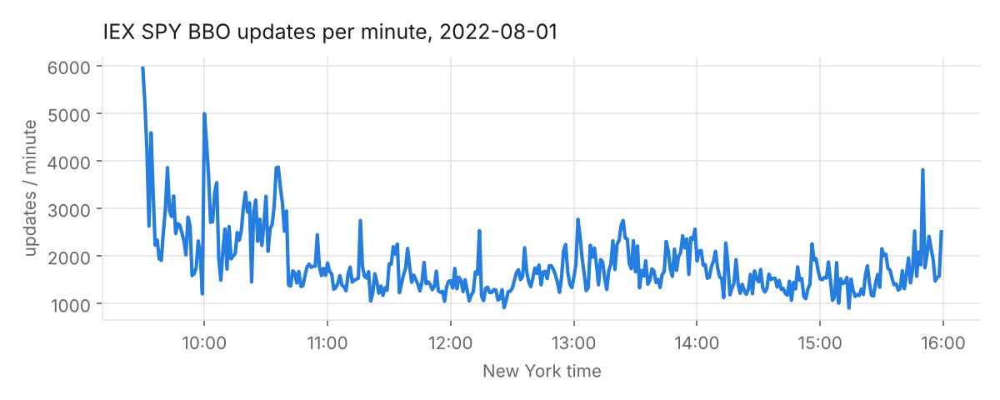
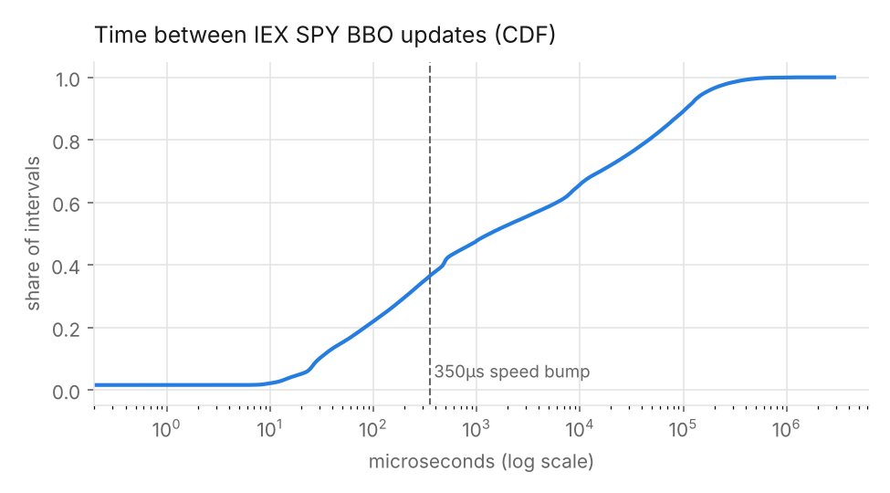
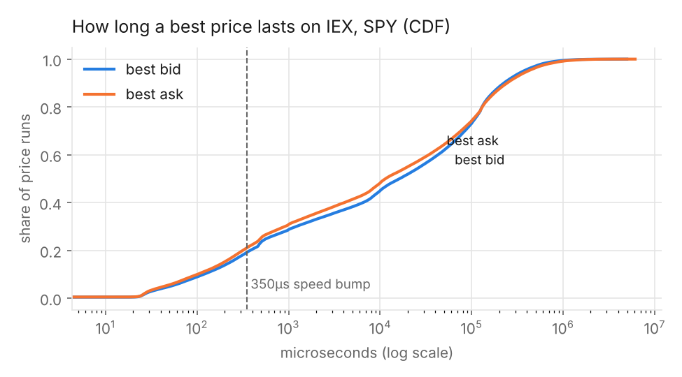
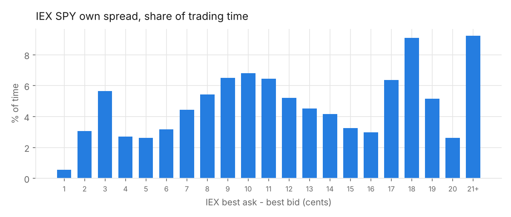

# IEX SPY BBO prototype, 2022-08-01

Source: course IEX DEEP parser tick file (price levels, not DEEP+). Regular hours 09:30-16:00 New York.
Timestamps: IEX-TP packet send time (not the message event time). Generated by `scripts/iex_bbo_prototype.py`.

## Headline numbers
- BBO updates: 714,832 (1,833 per minute)
- Best bid price changes: 276,592; best ask price changes: 261,343; size-only updates: 176,923
- Trades: 10,510 (1,191,235 shares)
- Time between BBO updates (µs): p10=30.0, p25=134.4, p50=1,342.9, p75=28,201.7, p90=106,636.1, p99=367,936.7, mean=32,735.0, n=714,831
- Best bid price lifetime (µs): p10=119.1, p25=579.4, p50=16,337.7, p75=108,708.6, p90=225,239.2, p99=786,600.8, mean=84,601.1, n=276,591
- Best ask price lifetime (µs): p10=101.5, p25=495.8, p50=11,480.3, p75=104,321.2, p90=243,765.3, p99=929,418.4, mean=89,537.4, n=261,343
- Best prices that lasted < 350µs: bid 19.2%, ask 21.0%
- Spread, share of time by cents: {"1.0": 0.0056, "2.0": 0.0306, "3.0": 0.0565, "4.0": 0.027, "5.0": 0.0263}

## Data checks
- Validation (full day): errors: 0, warnings: 0
- Our BBO vs. the course parser's level-1 snapshots: 818,336 of 818,336 match (100.00%)

## Figures

